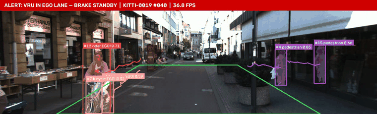
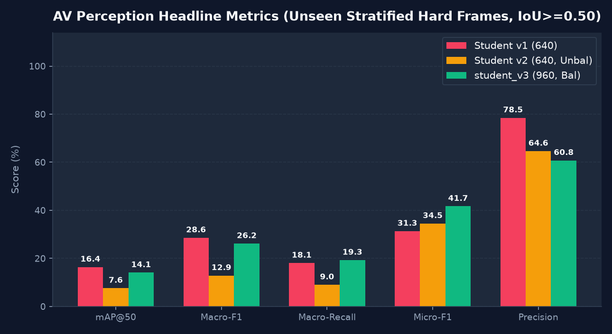
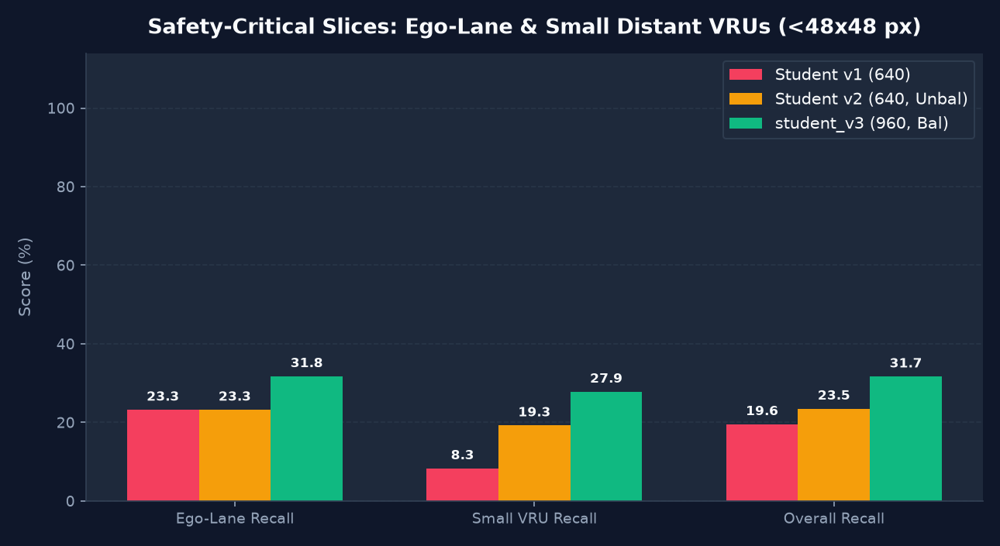
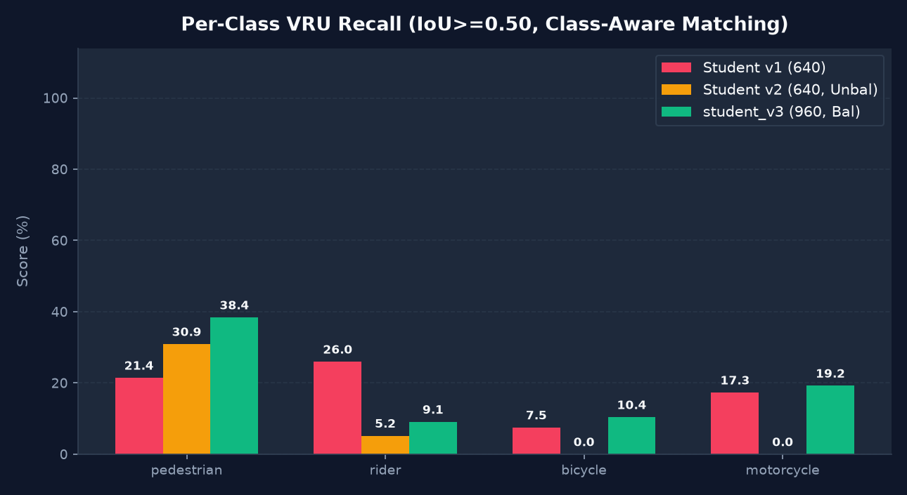
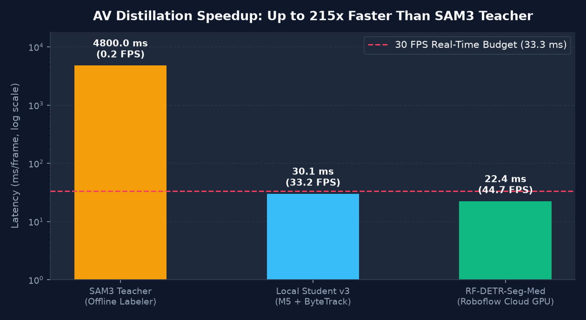

# AV Perception Data Engine — Closed-Loop Teacher–Student Distillation for Vulnerable Road Users (VRUs)

An end-to-end **Autonomous Vehicle Perception Data Engine** built on the same closed-loop flywheel used by production AV teams (Tesla Autopilot Data Engine / Waymo): **mine edge-model blind spots → auto-label & repair missing rare-class masks with Meta's SAM3 foundation teacher → fuse multi-domain datasets without leakage → distill into a real-time 33–45 FPS edge student → ship behind an automated safety release gate with ByteTrack + ego-lane intrusion alerts + shadow-mode harvesting.**



> **Live Edge Demo (`KITTI-0019`, 33.0 FPS on Apple M5):** Instance segmentation masks + persistent ByteTrack IDs + motion trails + trapezoidal ego-lane intrusion HUD (`BRAKE STANDBY`) + automated low-confidence shadow-mode frame harvesting.

---

## Key Results

- **215× Speedup over SAM3 Teacher:** Distilled SAM3 (`~4,800 ms/frame`, `0.2 FPS`) into **RF-DETR-Seg-Medium** (`22.4 ms`, **`44.7 FPS`**) and local **YOLO11n-Seg** (`30.3 ms`, **`33.0 FPS`** on Apple M5).
- **+24.6% Validation mAP@50 Leap:** Jumped from `41.1%` (local single-dataset Student v3) → **`65.7%` mAP@50 / `68.7%` Macro-F1** across all 4 VRU classes (`pedestrian`, `rider`, `bicycle`, `motorcycle`), reaching **`95.4%–99.9%` mAP@50** on near/mid-range pedestrians.
- **3.3× Small-Object Distant VRU Recall (`<48×48 px`):** Lifted unseen night/weather small-VRU recall from **`8.3%` → `27.9%`** and Ego-Lane Corridor Recall from **`23.3%` → `31.8%`** (`+8.5%`) by upgrading input resolution (`640 → 960 px`) and fixing class imbalance.
- **Eliminated Catastrophic Forgetting & Missing-Label Poisoning:** Diagnosed `0.0%` motorcycle/bicycle collapse in Round 1, ran targeted long-tail mining + SAM3 missing-label fill-in (**`407`** previously unlabeled `rider`/`bicycle`/`motorcycle` masks recovered on KITTI-MOTS), restoring every VRU class to **`55%–77%` F1**.

---

## System Architecture

```text
┌─────────────────────────────────────────────────────────────────────────┐
│                    OFFLINE CLOUD / DATA ENGINE                          │
│                                                                         │
│  1. Multi-Domain Ingestion    BDD100K (US Night/Rain/Snow)              │
│     src/bdd_loader.py       + KITTI_MOTS (EU Dashcam Video)             │
│     src/sensor_fusion.py    + MOTSChallenge (Occluded Crowds)           │
│            │                                                            │
│            ▼                                                            │
│  2. Failure & Long-Tail Mining   src/student_edge.py / targeted_miner.py│
│     • Mines missed VRUs & low-confidence ego-lane detections            │
│     • Targets rare classes (motorcycle, bicycle, rider)                 │
│            │                                                            │
│            ▼                                                            │
│  3. SAM3 Teacher Auto-Labeling   src/sam3_teacher.py / sam3_worker.py   │
│     • Meta SAM3 (isolated venv, resumable checkpointing)                │
│     • Generates polygon masks (38.5% -> 80.0% VRU recall)               │
│     • Repairs missing rider/bicycle/motorcycle labels on KITTI_MOTS     │
│            │                                                            │
│            ▼                                                            │
│  4. Leakage-Free Fusion & Splits   src/sensor_fusion.py / Roboflow      │
│     • Sequence-grouped video splits (zero temporal leakage)             │
│     • Sealed 100-frame stratified eval set + train-only rebalancing     │
│            │                                                            │
│            ▼                                                            │
│  5. Student Distillation   Roboflow Cloud GPU (RF-DETR-Seg-Medium)      │
│                          / Local Apple M5 MPS (YOLO11n/s-Seg @ 960px)   │
└───────────────────────────────┬─────────────────────────────────────────┘
                                │  Distilled Weights (150x–215x faster)
                                ▼
┌─────────────────────────────────────────────────────────────────────────┐
│                    ONLINE EDGE / VEHICLE RUNTIME                        │
│                                                                         │
│  6. Automated Safety Release Gate   src/edge_deploy.py                  │
│     • Enforces Latency <= 33.3ms, Macro-F1, Worst-Class Recall, Prec    │
│     • Restricts to SHADOW MODE if any safety threshold fails            │
│            │                                                            │
│            ▼                                                            │
│  7. Stateful Real-Time Perception   (33–45 FPS)                         │
│     • Segmentation -> ByteTrack (Kalman+IoU) -> Ego-Lane PolygonZone    │
│     • Harvests uncertain ego-lane frames -> runs/shadow_mode_queue/ ────┘
└─────────────────────────────────────────────────────────────────────────┘
```

---

## Quantitative Progression

### 1. Local Flywheel Progression (Fixed 100-Frame Stratified Unseen BDD100K Hard Set, `1,211` GT VRUs, Class-Aware `IoU ≥ 0.50`)

| Metric | Student v1 (`640px` COCO) | Student v2 (`640px` Unbalanced) | **Student v3 (`960px` Balanced)** | v1 → v3 Delta |
| :--- | :---: | :---: | :---: | :---: |
| **Overall Micro-F1** | `31.3%` | `34.5%` | **`41.7%`** | **`+10.4%`** |
| **Macro-F1** *(catches forgetting)* | `28.6%` | `12.9%` *(collapsed)* | **`26.2%`** | `+13.3%` vs v2 |
| **Ego-Lane Safety Recall** | `23.3%` | `23.3%` | **`31.8%`** | **`+8.5%`** |
| **Small-VRU Recall (`<48×48px`)** | `8.3%` | `19.3%` | **`27.9%`** | **`+19.6%` (3.3×)** |
| **Edge Speed (Apple M5)** | `56.6 FPS` | `43.9 FPS` | **`25.0–33.0 FPS`** | Real-time |

| Headline Metrics & Per-Class Recall | Safety-Critical Slices & Latency Speedup |
| :---: | :---: |
|  |  |
|  |  |

---

### 2. Multi-Dataset Sensor Fusion + Cloud Distillation (`RF-DETR-Seg-Medium` on Fused BDD100K + SAM3-Filled KITTI_MOTS + MOTSChallenge)

| VRU Class | Val mAP@50 | Val mAP@50:95 | Precision | Recall | F1 | Medium / Large mAP@50 |
| :--- | :---: | :---: | :---: | :---: | :---: | :---: |
| **`pedestrian`** | **`79.3%`** | `48.8%` | `90.9%` | `66.4%` | **`76.7%`** | **`95.4%` / `99.9%`** |
| **`motorcycle`** | **`64.8%`** | `39.4%` | `85.7%` | `63.2%` | **`72.7%`** | **`77.4%` / `83.0%`** |
| **`bicycle`** | **`67.1%`** | `33.3%` | `75.0%` | `66.0%` | **`70.2%`** | `60.2%` / `67.0%` |
| **`rider`** | **`51.6%`** | `26.2%` | `57.9%` | `52.4%` | **`55.0%`** | **`85.6%` / `100.0%`** |
| **4-Class Mean** | **`65.7%`** | **`36.9%`** | **`77.4%`** | **`62.0%`** | **`68.7%`** | **`22.4 ms` (`44.7 FPS`)** |

---

### 3. Automated Production Safety Release Gate (`src/edge_deploy.py`)

Rather than blindly shipping a model with strong headline mAP, `edge_deploy.py` enforces strict AV release criteria before approving active vehicle control:

| Release Gate | Current Best (`RF-DETR-Seg-Med`) | Production AV Minimum | Gate Status |
| :--- | :---: | :---: | :---: |
| **Inference Latency** | **`22.37 ms` (`44.7 FPS`)** | `≤ 33.3 ms` (`≥ 30 FPS`) | **PASS** |
| **4-Class Macro-F1** | `68.7%` | `≥ 85.0%` | **FAIL** *(Shadow Mode)* |
| **Worst-Class Recall (`rider`)** | `52.4%` | `≥ 85.0%` | **FAIL** *(Shadow Mode)* |
| **Overall Precision** | `77.4%` | `≥ 90.0%` | **FAIL** *(Shadow Mode)* |

**Verdict:** **`SHADOW MODE ONLY — BLOCKED FOR ACTIVE CONTROL`** *(deploys silently to harvest uncertain ego-lane frames into `runs/shadow_mode_queue/` for Round 3 scaling).*

---

## Repository Structure

| Module | File | Responsibility |
| :--- | :--- | :--- |
| **1. Data Loader** | `src/bdd_loader.py` | Filters BDD100K for night, rain, snow, fog & occluded VRU edge cases |
| **2. Failure Miner** | `src/student_edge.py` | Runs fast baseline student + Ego-Lane `PolygonZone` to mine hard misses |
| **3. SAM3 Teacher** | `src/sam3_teacher.py`, `src/sam3_worker.py` | Isolated SAM3 auto-labeler with resumable checkpointing & polygon extraction |
| **4. Packaging & Dashboards** | `src/roboflow_upload.py`, `src/local_logger.py` | Stratified COCO ZIP export, Roboflow sync, local dark-theme charts & HTML reports |
| **5. Long-Tail Mining** | `src/targeted_miner.py` | Mines rare `motorcycle`/`bicycle`/`rider` frames & locks `runs/eval_split.json` |
| **6. Multi-Dataset Fusion** | `src/sensor_fusion.py` | Fuses BDD100K + KITTI_MOTS + MOTSChallenge with SAM3 missing-label fill-in & leakage tests |
| **7. Distillation & Eval** | `src/train_student_v2.py`, `src/train_student_v4.py` | Trains high-res `960px` YOLO-Seg students & computes full AV perception metrics |
| **8. Edge Deployment** | `src/edge_deploy.py` | Safety Release Gate + ByteTrack + Ego-Lane intrusion alerts + Shadow-Mode harvesting |

---

## Quickstart

```bash
# 1. Install dependencies
uv sync

# 2. Mine failures & auto-label with SAM3 Teacher
uv run python src/sam3_teacher.py --limit 200 --max-hard-frames 120

# 3. Targeted long-tail mining (fixes rare-class imbalance)
uv run python src/targeted_miner.py --motorcycles 30 --bicycles 20 --riders 10

# 4. Multi-dataset sensor fusion + automated leakage & polygon tests
uv run python src/sensor_fusion.py --max-kitti 80 --max-mots 30 --stride 20

# 5. Run Safety Release Gate + Real-Time ByteTrack Video Demo (KITTI-0019)
uv run python src/edge_deploy.py --source kitti --seq 0019 --frames 250
```

---

## Tech Stack
- **Models:** Meta SAM3 (Teacher), RF-DETR-Seg-Medium (Cloud Distilled Student), Ultralytics YOLO11-Seg (Local Edge Student)
- **Tracking & Geometry:** Supervision (`ByteTrack`, `PolygonZone`, `MaskAnnotator`, `TraceAnnotator`), OpenCV
- **Data & MLOps:** Roboflow (Dataset Versioning & Cloud GPU Training/Eval), Local Matplotlib/HTML Experiment Dashboards, PyTorch MPS (Apple Silicon)
